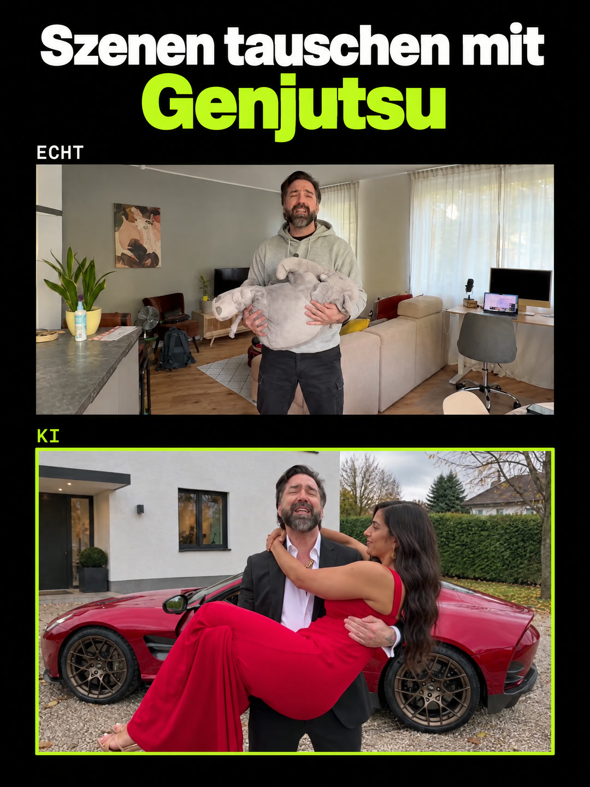

# Making-of: Szenen tauschen mit Genjutsu

<!-- VIDEO -->

Ein Reel im Hochformat, oben die KI-Fassung, unten der echte Dreh. Gedreht im Wohnzimmer: ein Kuscheltier auf dem Arm, ein Beutel, ein Sofa. Higgsfield Genjutsu hat daraus eine Frau im roten Kleid, ein Bündel 500-Euro-Scheine, ein Coupé und die Einfahrt einer Villa gemacht. Gesicht, Stimme und jede Bewegung blieben echt. Hier steht, wie das Reel entstanden ist: Ablauf, Eingaben, Prompt, Kosten und was wir dabei gelernt haben.

| | |
|---|---|
| Länge | 27,4 s im Reel, der Genjutsu-Lauf über 29,5 s |
| Format | 9:16, 1080 × 1920; oben KI, unten echt, Untertitel dazwischen |
| Verfahren | Higgsfield Genjutsu im Modus Objects swap, ein Lauf, 720p |
| Vorlage | eigener Dreh, 16:9, Kamera fest, iPhone |
| Gebaut | am 31. Oktober 2026 |

## Inhalt

- [Ablauf](#ablauf)
- [Eingaben](#eingaben)
- [Werkzeuge](#werkzeuge)
- [Kosten](#kosten)
- [Was wir gelernt haben](#was-wir-gelernt-haben)
- [Verworfene Wege](#verworfene-wege)
- [Selbst bauen](#selbst-bauen)
- Prompts zum Kopieren: [prompts/](prompts/)

## Ablauf

1. **Dreh.** Kamera fest, quer, die ganze Handlung im Bild. Platzhalter in Größe und Gewicht ähnlich wie das, was daraus werden soll: Kuscheltier für die Person, Beutel für das Geld, Sofa für das Auto. Jede Aktion deutlich spielen, Würfe in eine klare Richtung.
2. **Umrechnen.** Das iPhone hat in HDR gedreht (HLG, Dolby Vision). Erst nach SDR umrechnen, mit dem Apple-Weg `avconvert`. Standbilder genauso ziehen. Sonst werden Bilder flau und Hauttöne kippen.
3. **Referenzen.** Ein Bild je Element, im Seitenverhältnis des Videos, nur das, was getauscht werden soll: das Outfit ohne Gesicht, jede neue Person, jedes Objekt, der leere Ort. Feste Objekte wie das Auto als echtes Foto, Kennzeichen und Logos entfernt.
4. **Prompt.** Englisch, ein Block je Element, jede Richtung und jeder Zeitpunkt ausgeschrieben, jedes sichtbare Kleidungsstück bis zu den Schuhen ([genjutsu-objects-swap.txt](prompts/genjutsu-objects-swap.txt), Gerüst in [prompt-geruest.txt](prompts/prompt-geruest.txt)).
5. **Lauf.** Objects swap über die ganze Länge in einem Lauf, 720p. In der Oberfläche die Bildmarken prüfen: „@image1“ plus Enter wählt zuerst „Video 1“.
6. **Prüfen.** Bild für Bild gegen das Original, als Kontaktbogen und an jeder Aktion: Richtung, Schuhe, Türen, Ausschnitt, erfundene Details.
7. **Ton.** Stimme aus dem Original freigestellt, dazu eine Atmo des neuen Ortes. Effekte nur auf Bildereignisse wie Wurf und Geld, kurz und leise. Musik unter der Stimme, sie duckt beim Sprechen und setzt beim Wurf kurz aus. Am Ende −14 LUFS.
8. **Schnitt fürs Reel.** 9:16 auf Schwarz: oben der Titel, darunter der KI-Clip randlos, ein schmales Band mit Untertiteln, darunter das Original, unten der Aufruf. Der ganze Block sitzt mittig.

## Eingaben

| Eingabe | Was | Woher |
|---|---|---|
| Video | eigener Dreh, 29,5 s, 16:9, Kamera fest | iPhone, vorher von HDR nach SDR umgerechnet |
| @Image1 · Outfit | Anzug, offenes Hemd, Goldkette, ohne Gesicht | Standbild aus dem Dreh, Anzug per Bild-Edit (Nano Banana Pro) |
| @Image2 · Person | Frau im roten Kleid, ganze Figur auf ruhigem Grund | GPT Image 2.5 |
| @Image3 · Objekt | Bündel mit Banderole und lose Scheine | GPT Image 2.5 |
| @Image4 · Ort | Einfahrt einer Villa, leer, im Look eines Handyfotos | GPT Image 2.5 |
| @Image5 · Auto | rotes Coupé | echtes Foto aus dem Netz, Kennzeichen per Bild-Edit entfernt; das Foto selbst liegt nicht in diesem Repository |

## Werkzeuge

| Werkzeug | Wofür | Bezugsquelle |
|---|---|---|
| Higgsfield Genjutsu | Objects swap über das ganze Video | [higgsfield.ai](https://higgsfield.ai) |
| Higgsfield Bildmodelle | Referenzbilder (GPT Image 2.5) und Bild-Edits (Nano Banana Pro) | [higgsfield.ai](https://higgsfield.ai) |
| Claude Code | Planung, Prompt, Prüfung, alle Skripte für Schnitt und Ton | [claude.com/claude-code](https://claude.com/claude-code) |
| ElevenLabs | Stimme freistellen, Effekte, Musik | [elevenlabs.io](https://elevenlabs.io) |
| ffmpeg | Umrechnen, Schnitt, Mischung, Lautheit | [ffmpeg.org](https://ffmpeg.org) |
| Chrome ohne Fenster | Titel, Untertitel und Aufruf als Ebenen | [google.com/chrome](https://www.google.com/chrome/) |

## Kosten

| Posten | Kosten |
|---|---|
| Genjutsu-Lauf, 29,5 s in 720p | 210 Credits; bei uns ein Gratis-Lauf aus dem Higgsfield-Abo |
| Referenzbilder samt Fehlversuchen | rund 20 Credits |
| Ton, erste Runde | rund 1.150 ElevenLabs-Credits |

Genjutsu-Preise bei Higgsfield, Stand 31.10.2026: in der Oberfläche 29,5 s in 720p 210 Credits; per Kommandozeile 15 s in 720p 105 Credits; Genjutsu Lite 2 Credits je Sekunde; über die API 0,318 $ je Sekunde in 480p und 0,681 $ in 720p (Listenpreis). Das Eingangsvideo wird auf volle Sekunden aufgerundet.

## Was wir gelernt haben

1. **Tauschen statt neu bauen.** Ein Objects-swap-Lauf über 29,5 s hat Gesicht, Stimme und jede Bewegung behalten und trotzdem das Wohnzimmer gegen eine Villa-Einfahrt getauscht.
2. **Was nicht dasteht, bleibt oder geht verloren.** Die Oberfläche schreibt den Prompt intern um, dabei fiel die Wurfrichtung weg. Zum Anzug trug die Figur die Badelatschen aus dem Original. Richtungen und Schuhe ausschreiben, dann prüfen.
3. **Echtes Foto schlägt generiertes Auto.** Zwei Bildmodelle haben die Autotür in drei Versuchen falsch angeschlagen. Mit einem echten Foto ohne Kennzeichen saß sie.
4. **Erst das Original richtig umrechnen.** Die ersten Standbilder kamen aus dem HDR-Video ohne Umrechnung: flau und mit falschen Hauttönen. Zwei Anzug-Edits bauten darauf auf und flogen raus.
5. **Ton in kleinen Schritten.** Fünf neue Klänge auf einmal machten den Ton schlechter. Gewonnen hat die ruhige Fassung: ein kurzer, leiser Schrei, Geldscheine dezent.

## Verworfene Wege

- **Anzug auf flauem Standbild.** HDR nicht umgerechnet, dazu erfundene Tattoos auf den Händen.
- **Geländewagen statt Coupé.** Zu hoch für die tiefe Sitzposition im Dreh, das Emblem war erfunden.
- **Generiertes Auto im Ort.** Die Tür war dreimal falsch angeschlagen, mit zwei Bildmodellen.
- **Sonnenuntergang im Hochformat.** Wirkte künstlich. Außerdem ist das Video 16:9.
- **Wan 3.0 Prime statt Genjutsu.** Dieselbe Szene aus Referenzbildern und Video neu erzeugt (3,67 $ Listenpreis). Das Modell tauscht nicht, es baut alles neu: Ein Ausfallschritt fehlte, wegen der Grenze von rund 15 s brauchte es zwei Läufe, in der zweiten Hälfte stand die geworfene Frau wieder neben dem Auto, alles in weichem 480p.

## Selbst bauen

Für deine eigene Szene gibt es die Anleitung als Text für deine KI und als PDF:

- Als Text zum Weitergeben an deine KI: [prompts/anleitung-fuer-die-ki.md](prompts/anleitung-fuer-die-ki.md)
- Als PDF: [anleitung.pdf](anleitung.pdf)

Lizenz: Texte und Prompts unter CC BY 4.0, siehe [LICENSE](LICENSE) und [NOTICE.md](NOTICE.md). Video und Bilder des Reels nur zum Ansehen.

---

Public Impact · [publicimpact.ai](https://publicimpact.ai) · hey@publicimpact.ai
